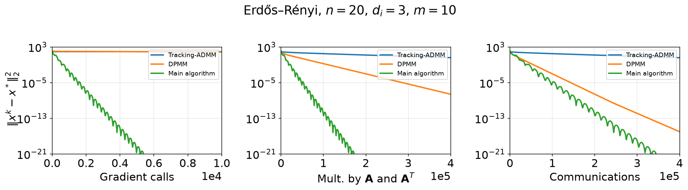
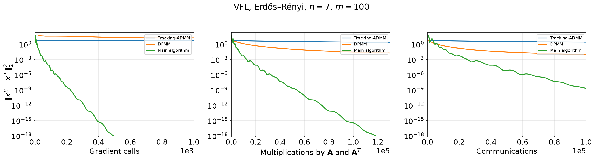

# Decentralized Optimization with Coupled Constraints

**ICLR 2025 论文复现 · M1–M4**

本仓库是论文 [*Decentralized Optimization with Coupled Constraints*](https://openreview.net/forum?id=AJM52ygi6Y)（ICLR 2025）的独立复现。官方代码由论文作者开源在 [kisnikser/Decentralized-Optimization](https://github.com/kisnikser/Decentralized-Optimization)；本仓库保留官方根目录下的 `models.py`、`methods.py`、`utils.py` 和 notebooks 不变，新增：

- `repro/`：四个复现模块 M1–M4、独立实现、统一实验脚本；
- `docs/figs/`：正式运行得到的结果图；
- `repro/outputs/`：运行后生成的图、报告和原始 pickle（不提交到 git）。

> **TL;DR**
> - M1 的 Assumptions 1–3 与 Lemma 1–5 在三个官方模型上全部通过。
> - M2 的独立 Main 实现与官方 `methods.Main` 逐步一致，`x_err` 相对误差 ≤ `1.3e-11`。
> - M3（合成线性回归）中，Main 用 1 万次梯度调用达到 `1.8e-25`；Tracking-ADMM 和 DPMM 分别用约 579 万、365 万次梯度调用，最终误差分别为 `3.95`、`1.1e-21`。
> - M4（VFL）中，Main 用 1 000 次梯度调用达到 `5.5e-21`；DPMM 用约 326 万次梯度调用仍为 `9.0e-3`，Tracking-ADMM 基本未收敛。
> - 本机完整正式实验（非 smoke）约 **8 分钟**。

---

## 1. 论文解决的问题

考虑 `n` 个 agent 组成的通信网络。Agent `i` 持有局部目标 `f_i`、矩阵 `A_i` 和向量 `b_i`，共同求解

$$
\min_{x_1,\dots,x_n} \sum_{i=1}^n f_i(x_i)
\quad \text{s.t.} \quad
\sum_{i=1}^n (A_i x_i - b_i) = 0 .
$$

与常见的“每个 agent 各自满足约束”不同，这里的约束把所有 agent **耦合**在一起；agent 之间只能沿通信图 `W` 交换信息。论文在 Assumptions 1–3 下将问题转化为增广目标

$$
G(x,y) = F(x) + \frac{r}{2}\left\|Ax + \gamma W'y - b\right\|^2,
\qquad
r = \frac{\mu_f}{2L_A},
\quad
\gamma^2 = \frac{\mu_A+L_A}{\mu_W'},
$$

并用 APAPC 结合 Chebyshev 加速得到 Main 算法。Theorem 1 的资源复杂度为

| 资源 | 复杂度 |
|---|---|
| 梯度调用 | $O(\sqrt{\kappa_f}\log(1/\varepsilon))$ |
| 乘 `A` / `Aᵀ` | $O(\sqrt{\kappa_f\kappa_A}\log(1/\varepsilon))$ |
| 通信 | $O(\sqrt{\kappa_f\kappa_A\kappa_W}\log(1/\varepsilon))$ |

其中 `κ_f=L_f/μ_f`、`κ_A=L_A/μ_A`、`κ_W` 是图矩阵条件数。M1/M2 验证理论，M3/M4 在合成问题和 VFL 上复现论文的数值结论。

## 2. 复现模块 M1–M4

| 模块 | 对应论文内容 | 做什么 | 入口 | 详细说明 |
|---|---|---|---|---|
| **M1** | Assumptions 1–3、Lemma 1–5 | 在官方模型上数值检查强凸/光滑常数、算子谱、Chebyshev 多项式与官方算子实现 | `python repro/m1_theory/lemma_checks.py` | [M1 README](repro/m1_theory/README.md) |
| **M2** | Main 算法、Theorem 1 | 用显式稠密矩阵独立实现 Main，与官方实现逐步对齐；扫描 `κ_f`、`κ_A`、`κ_W` 拟合资源斜率 | `python repro/m2_main_complexity/compare_with_official.py --steps 20`<br>`python repro/m2_main_complexity/complexity_sweep.py` | [M2 README](repro/m2_main_complexity/README.md) |
| **M3** | Figure 1、`r` 消融 | 复现合成线性回归的 Figure 1；扫描增强系数 `r` | `python repro/m3_figure1/reproduce_figure1.py`<br>`python repro/m3_figure1/ablation_r.py` | [M3 README](repro/m3_figure1/README.md) |
| **M4** | Figure 2、consensus、标签分布式 VFL | 复现 VFL Figure 2；复现官方 `consensus.ipynb` 的 Main vs EXTRA；覆盖 `labels_distribution=True` 分支 | `python repro/m4_vfl_consensus/reproduce_figure2.py`<br>`python repro/m4_vfl_consensus/consensus_extra.py`<br>`python repro/m4_vfl_consensus/labels_distributed.py` | [M4 README](repro/m4_vfl_consensus/README.md) |

各模块的完整说明、参数和输出文件见 [`repro/README.md`](repro/README.md) 及对应模块的 README。

## 3. 快速开始

### 环境

```bash
git clone https://github.com/OnGlacier/iclr2025-coupled-constraints-repro.git
cd iclr2025-coupled-constraints-repro

conda env create -f environment.yml
conda activate decentralized-opt
```

如果已有 Python 环境，也可以直接安装依赖：

```bash
pip install -r requirements.txt
```

测试环境为 Python 3.11.17、NumPy 2.4.6，纯 CPU；`data/` 中的 `mushrooms`、`a9a`、`w8a` 已随仓库提供，不需要额外下载。

### 运行

```bash
# 快速检查：四个模块各跑一个小规模版本，约 1–2 分钟
bash repro/run_smoke.sh

# 完整正式实验：M1–M4 全部非 smoke 配置，本机约 8 分钟
bash repro/run_formal_all.sh
```

`run_formal_all.sh` 是本 README 结果所用的入口；`repro/run_full.sh` 运行同一组正式实验，只是任务顺序不同。smoke 与正式运行共用 `repro/outputs/` 路径，跑完 smoke 后若要正式图，请重新运行 `run_formal_all.sh`。

也可以单独运行某个模块：

```bash
python repro/m1_theory/lemma_checks.py
python repro/m2_main_complexity/compare_with_official.py --steps 20
python repro/m2_main_complexity/complexity_sweep.py
python repro/m3_figure1/reproduce_figure1.py
python repro/m3_figure1/ablation_r.py
python repro/m4_vfl_consensus/reproduce_figure2.py
python repro/m4_vfl_consensus/consensus_extra.py
python repro/m4_vfl_consensus/labels_distributed.py
```

所有脚本都从**仓库根目录**运行。输出统一写到：

```text
repro/outputs/
├── figs/       # PDF + PNG
├── dumps/      # 原始结果 pickle，可用于重绘
└── reports/    # JSON / CSV 汇总
```

`repro/outputs/` 默认被 `.gitignore` 忽略；本 README 中的图已复制到 `docs/figs/`。

---

## 4. 正式实验结果

以下数值来自非 smoke 的正式运行（固定随机种子；具体末位会随 CPU/BLAS 略有差异）。

### 4.1 M1：假设与引理

在 `example_er`（Figure 1 模型）、`example_ring`、`consensus_ring` 上，默认 20 次随机试验，Assumptions 1–3 与 Lemma 1–5 **全部 PASS**（`all_passed: true`）：

| 模型 | `κ_f` | `κ_A` | `κ_W`（官方代码约定） | 结果 |
|---|---:|---:|---:|---|
| `example_er` | 3140.31 | 26.75 | 88.66 | PASS |
| `example_ring` | 1531.30 | 20.22 | 109.67 | PASS |
| `consensus_ring` | 9990.02 | 4.00 | 6.85 | PASS |

报告：`repro/outputs/reports/lemma_checks.json`。

### 4.2 M2：独立实现与复杂度斜率

#### 与官方实现逐步对齐

用 `main_impl.py` 的显式、稠密 Main 与官方 `methods.Main` 从同一初值出发逐步比较。20 步正式对比全部通过；另做了 100 步稳定性检查，结论相同：

| 模型 | `x_err` 相对误差（20 步） | `x_err` 相对误差（100 步） | 最终 `x` 相对误差（100 步） | 官方 / 真实通信（每步） |
|---|---:|---:|---:|---:|
| `example_er` | `7.9e-14` | `1.3e-11` | `2.1e-11` | 64 / 320 |
| `example_ring` | `2.6e-13` | `3.5e-12` | `3.9e-12` | 56 / 308 |
| `consensus_ring` | `3.4e-15` | `8.8e-14` | `2.0e-13` | 32 / 48 |
| `vfl_small` | `1.1e-11` | `1.1e-11` | `6.9e-10` | 480 / 4080 |

四个模型的 `grad_calls`、`mults_A`、`communications` 三个计数器也逐元素完全一致，说明独立实现与官方算法在更新公式和资源计量上一致。

报告：`repro/outputs/reports/m2_compare.json`、`repro/outputs/reports/m2_compare_100.json`。

#### Theorem 1 斜率

在受控二次模型上扫描三个条件数，记录达到 `||x^k-x*||² < 1e-8` 的累计资源，并做 log–log 最小二乘拟合：

| 扫描变量 | 梯度调用 | `A`/`Aᵀ` 乘法 | 通信（官方计数器） | 通信（真实 `W` 乘法） | 理论斜率 |
|---|---:|---:|---:|---:|---|
| `κ_f` | 0.502 | 0.502 | 0.502 | 0.502 | 全部 `1/2` |
| `κ_A` | 0.046 | 0.452 | 0.452 | 0.452 | 梯度 `0`；`A`/通信 `1/2` |
| `κ_W` | 0.034 | 0.034 | 0.034 | **0.513** | 梯度/`A` 为 `0`；通信 `1/2` |

`κ_f`、`κ_A` 方向与 Theorem 1 一致。`κ_W` 方向出现了一个重要现象：**官方通信计数器没有计入 `mulW_prime` 内部的 Chebyshev 次数**，所以官方口径的通信斜率只有 0.034；改成真实 `W` 乘法次数后，斜率恢复为 0.513，符合 `O(√κ_W)`。详见 [M2 README](repro/m2_main_complexity/README.md)。

图：`repro/outputs/figs/m2_sweep_kappa_{f,A,W}.{pdf,png}`。

### 4.3 M3：Figure 1（合成线性回归）

配置与官方 `example.ipynb` 一致：

```python
ExampleModel(20, 10, 3, 'erdos-renyi', edge_prob=5/20, gossip=False)
n=20, m=10, d_i=3, κ_f≈3140.31, κ_A≈26.75, κ_W≈88.66
```

Main 跑 10 000 步；Tracking-ADMM、DPMM 按官方 notebook 的慢速 baseline 约定分别放大 10×、100×：

| 方法 | 迭代数 | 最终 `||x-x*||²` | 梯度调用 | `A`/`Aᵀ` 乘法 | 通信（官方口径） | 时间 |
|---|---:|---:|---:|---:|---:|---:|
| Tracking-ADMM | 100 000 | `3.95e+00` | 5 789 884 | 400 000 | 400 000 | 28.8 s |
| DPMM | 1 000 000 | `1.05e-21` | 3 648 709 | 2 000 000 | 1 000 000 | 92.1 s |
| **Main** | **10 000** | **`1.84e-25`** | **10 000** | **320 000** | **640 000** | **12.2 s** |



*图：M3 复现的论文 Figure 1。三个面板分别为梯度调用、`A`/`Aᵀ` 乘法和通信次数；绿色 Main 曲线在远少于 baseline 的梯度调用下达到更低误差。*

在这个有限步数实验中，Main 的通信量不是最低（64 万，Tracking-ADMM 为 40 万），但梯度调用少 2–3 个数量级；最终误差比 Tracking-ADMM 低 20 个数量级以上，也比 DPMM 低 3 个数量级以上。这正是论文强调的**通信–计算权衡**。

#### `r` 消融

固定模型和 10 000 步，扫描官方 notebook 中的 `r_values`：

| `r` | `1e-7` | `1e-6` | `2e-5` | `1e-3` | `1e-1` | `4e-1` |
|---|---:|---:|---:|---:|---:|---:|
| 最终 `||x-x*||²` | `2.92e-25` | `1.34e-24` | `7.27e-25` | `2.45e-25` | `3.52e-24` | `2.35e-24` |

六组取值全部达到 `1e-15` 以下，没有发散；曲线基本重合，`r=4e-1` 在后期略慢。默认理论值 `r=μ_f/(2L_A)` 约为 `2.1e-5`，说明算法在这一范围内都能稳定收敛，最终精度接近。

图：[`docs/figs/m3_r_ablation.png`](docs/figs/m3_r_ablation.png)。报告：`repro/outputs/reports/m3_r_ablation.json`。

### 4.4 M4：Figure 2（VFL）

配置：

```python
VFL(7, lmbd=1e-2, title='mushrooms', sample_size=100,
    graph='erdos-renyi', edge_prob=5/100, gossip=False,
    labels_distribution=False)
n=7, m=100, d=16, λ=1e-2
κ_f=50, κ_A≈1770.18, κ_W≈277.20
```

Main 跑 1 000 步；Tracking-ADMM、DPMM 放大 100×（各 100 000 步）：

| 方法 | 迭代数 | 最终 `||x-x*||²` | 梯度调用 | `A`/`Aᵀ` 乘法 | 通信（官方口径） | 时间 |
|---|---:|---:|---:|---:|---:|---:|
| Tracking-ADMM | 100 000 | `9.95e-01` | 300 620 | 400 000 | 400 000 | 16.5 s |
| DPMM | 100 000 | `9.05e-03` | 3 259 866 | 200 000 | 100 000 | 198.0 s |
| **Main** | **1 000** | **`5.52e-21`** | **1 000** | **240 000** | **480 000** | **25.3 s** |



*图：M4 复现的论文 Figure 2（VFL，Erdős–Rényi，`n=7`，`m=100`）。Main 在 1 000 次梯度调用内下降到 `1e-18` 以下；DPMM 用约 326 万次梯度调用后仍为 `9e-3`，Tracking-ADMM 用约 30 万次后仍为 `1.0`。*

Main 在 500 步时已达到 `5.79e-19`，图中所画曲线在 1 000 步处低于纵轴下限 `1e-18`。与 M3 一样，Main 的通信量在该设置下高于 DPMM，但梯度调用少 3 个数量级。

#### consensus 补充实验

官方 `consensus.ipynb` 对应 `ConsensusModel(5, 10, 'ring', condition_number=10000)`；Main 跑 10 000 步，EXTRA 跑 300 000 步：

| 方法 | 迭代数 | 最终 `||x-x*||²` | 梯度调用 | `A`/`Aᵀ` 乘法 | 通信 |
|---|---:|---:|---:|---:|---:|
| **Main** | **10 000** | **`1.33e-27`** | **10 000** | 160 000 | 320 000 |
| EXTRA | 300 000 | `9.77e-14` | 300 000 | 300 000 | 300 000 |

Main 用 30× 更少的梯度调用达到低得多的误差，通信次数仅比 EXTRA 高约 6.7%，符合“用少量额外通信换取大量计算节省”的定位。图：[`docs/figs/m4_consensus.png`](docs/figs/m4_consensus.png)。

#### 标签分布式 VFL（notebook extra）

配置：

```python
VFL(2, lmbd=1.0, title='mushrooms', sample_size=1000,
    graph='erdos-renyi', edge_prob=1/1000, gossip=False,
    labels_distribution=True)
```

三种方法各跑 100 步：

| 方法 | 最终 `||x-x*||²` | 梯度调用 | `A`/`Aᵀ` 乘法 | 通信（官方口径） |
|---|---:|---:|---:|---:|
| Tracking-ADMM | `1.34e+01` | 399 | 400 | 400 |
| DPMM | `1.83e-01` | 12 149 | 200 | 100 |
| **Main** | **`1.20e-14`** | **100** | **58 200** | **116 400** |

该实验不属于论文 Figure 2，保留它是为了覆盖官方代码的 `labels_distribution=True` 分支。APAPC 被省略，原因见下节。报告：`repro/outputs/reports/m4_labels_distributed.json`。

---

## 5. 复现口径与已知问题

官方根目录代码**没有做任何修改**；以下问题通过独立实现或显式配置绕开，并在各模块 README 中详细说明。

1. **官方通信计数器与真实通信量不一致。** 官方 `methods.Main` 每步记录
   `2 * ceil(sqrt(kappa_W_prime)) * (n_B + 1)`，其中 `kappa_W_prime ≈ 2.98`，前因子恒为 2；
   它没有计入 `mulW_prime` 内部 `n_W = ceil(sqrt(kappa_W))` 次 `W` 乘法。M2 同时报告
   `communications`（官方口径）和 `communications_true`（真实 `W` 乘法），因此 M2 的
   `κ_W` 斜率在两种口径下分别为 0.034 和 0.513。M3/M4 的图沿用官方口径，以便与论文
   横轴直接对照；讨论真实通信成本时应看 `communications_true`。例如 Figure 2 的 Main
   官方计数为 48 万，真实 `W` 乘法为 408 万。
2. **Figure 2 的实际 ER 图比“平均度 5”稀疏。** 论文只说明使用 Erdős–Rényi 图，未给平均度；
   官方 notebook 的 VFL 约定为 `edge_prob = average_degree / sample_size = 5/100`。
   `get_ER_W` 会重采样直到图连通，因此 `n=7` 时实际得到 6 条边、平均度约 1.71 的连通图
   （不是平均度 5），对应 `κ_W≈277.2`。实验报告中的 `num_edges`、`actual_average_degree`
   和 `degrees` 记录的是实际图，不是目标参数。
3. **官方 `APAPC` 无法直接运行。** `methods.APAPC` 读取 `model.bB`，`Model.grad_G`
   读取 `model.bW`，但 `Model` 从未赋值这两个属性，运行会抛 `AttributeError`。
   论文 Figure 2 只比较 Tracking-ADMM、DPMM、Main，不含 APAPC；labels-distributed
   补充实验也相应省略 APAPC。
4. **`κ_W` 的约定。** 官方代码中 `mu_W`/`L_W` 存的是 `W` 特征值的平方，因此
   `κ_W=(λ_max/λ_min)^2`；Figure 1 的 `88.66` 与论文 caption 一致。若按论文式 (6) 的
   `λ_max/λ_min` 理解，则应为 `sqrt(88.66)≈9.42`。M1/M2 的报告同时给出两个量。
5. **随机性。** 所有实验固定种子（Figure 1/2 为 307），但 BLAS、CPU 和 NumPy 版本仍可能
   造成末位差异；`outputs/` 中的 pickle 可用于在不重跑算法的情况下重绘曲线。

## 6. 仓库结构

```text
.
├── models.py, methods.py, utils.py     # 官方核心实现，未修改
├── example.ipynb, vfl.ipynb, consensus.ipynb
├── data/                               # mushrooms / a9a / w8a
├── repro/
│   ├── common.py                       # 路径、绘图、JSON/pickle 工具
│   ├── m1_theory/                      # Assumptions + Lemmas
│   ├── m2_main_complexity/             # 独立 Main + 复杂度扫描
│   ├── m3_figure1/                     # Figure 1 + r 消融
│   ├── m4_vfl_consensus/               # Figure 2 + consensus + labels
│   ├── outputs/                        # 运行时生成，git-ignored
│   ├── run_smoke.sh
│   └── run_formal_all.sh
├── docs/figs/                          # README 使用的正式结果图
├── environment.yml
└── requirements.txt
```

官方 notebooks 保留原样。`example.ipynb` 对应 M3 的 Figure 1 配置；`vfl.ipynb` 当前默认
`n=14`、`sample_size=8124`、ring 图，**不是**论文 Figure 2 的 `n=7`、`m=100` 配置，M4 使用
论文配置；`consensus.ipynb` 的已知问题（未定义的 `average_degree`、未初始化的 `results`）
在 `consensus_extra.py` 中已修正。

## 7. 引用与致谢

如果使用本仓库的复现代码，请同时引用原论文：

```bibtex
@inproceedings{yarmoshik2025decentralized,
  title     = {Decentralized Optimization with Coupled Constraints},
  author    = {Yarmoshik, Demyan and Rogozin, Alexander and Kiselev, Nikita
               and Dorin, Daniil and Gasnikov, Alexander and Kovalev, Dmitry},
  booktitle = {International Conference on Learning Representations (ICLR)},
  year      = {2025}
}
```

- 论文：<https://openreview.net/forum?id=AJM52ygi6Y>
- 官方代码：<https://github.com/kisnikser/Decentralized-Optimization>
- 本复现仓库：<https://github.com/OnGlacier/iclr2025-coupled-constraints-repro>

感谢论文作者开源代码与实验配置。本仓库中的复现代码、结果解释和已知问题记录仅代表本仓库，
不代表原作者。
